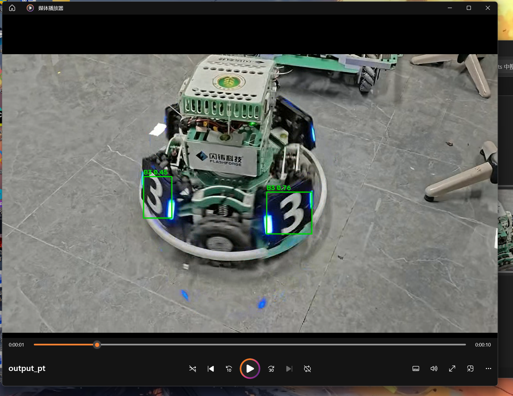
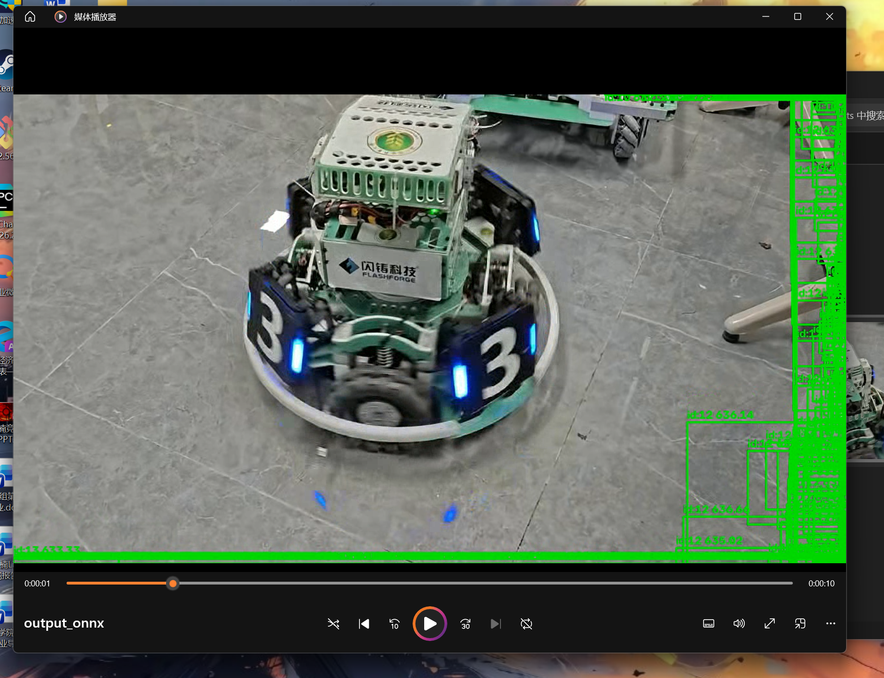

# YOLO 模型格式转换与推理对比 (YOLO-Export-Inference)

## 1. 本次使用的 YOLO 模型版本
本次作业基于上一份作业中的 YOLO26n 装甲板模型 `best.pt`。

## 2. 导出的模型格式及导出方法
- **导出格式**：ONNX (.onnx)
- **导出方法**：编写 `export.py`，调用 `ultralytics` 库的 `model.export(format='onnx')` 接口完成转换。

## 3. 运行环境与依赖库
- 操作系统：Windows 11
- Python 版本：3.12.3
- 硬件：CPU (Intel Core i7-14650HX)
- 核心依赖：`ultralytics`, `onnx`, `onnxruntime`, `opencv-python`

## 4. 模型推理的具体运行命令
```bash
# 1. 导出模型
python export.py
# 2. 运行对比推理
python inference.py
```
## 5. 原始模型与导出模型的推理结果截图
| 原始 .pt 模型 | 导出 .onnx 模型 |
| :---: | :---: |
|  |  |

## 6. 模型大小、推理耗时及检测效果对比

| 对比项目 | 原始 .pt 模型 | 导出后的 .onnx 模型 |
| :--- | :--- | :--- |
| **模型格式** | .pt | .onnx |
| **模型文件大小** | 5.62 MB | 9.72 MB |
| **平均推理耗时** | 16.81 ms/帧 | 59.38 ms/帧 |
| **检测目标数量** | 448 个 | 99300 个 |
| **检测效果** | 结果详见 output_pt.mp4 | 结果详见 output_onnx.mp4 |

## 7. 实验过程中遇到的问题及解决方法
- **问题1**：在使用 `results[0].plot()` 绘制 ONNX 推理结果时，出现了 `KeyError: 12` 报错。
  - **解决**：原因是直接加载 ONNX 模型时缺失了类别名称元数据。通过手动读取 `box.cls` 和 `box.conf`，并使用 OpenCV 自行绘制检测框，成功绕开了官方接口的元数据缺失问题。
- **问题2**：ONNX 模型检出的目标数量（99300）远大于原始 PT 模型（448）。
  - **解决/分析**：因为将 PT 导出为 ONNX 时，默认没有包含非极大值抑制（NMS）等后处理步骤。导致 ONNX 输出了所有候选框。正式部署时，需配合代码编写 NMS 后处理逻辑。

## 8. 对不同模型格式的理解与实验结论
- **理解**：`.pt` 格式依赖于 PyTorch 环境，包含了完整结构和后处理；`.onnx` 是通用交换格式，剥离了特定框架依赖，通用性强，但部分后处理需要自行编写。
- **结论**：本次实验中，ONNX 体积（9.72MB）略大于 PT（5.62MB）。在 CPU 环境下，ONNX 因缺少底层加速且产生海量冗余框，单帧耗时（59.38ms）慢于 PT（16.81ms）。这说明 ONNX 部署需要配合后处理和硬件加速（如 TensorRT）才能发挥优势。
